<p align="center">
  
</p>

<h1 align="center">OpenHeronBrowser (Demo)</h1>

<h3 align="center">An attempt at an open, independent web browser, with its own engine written from scratch in Rust.</h3>

<p align="center">
  HTML parser · CSS engine · layout · text · painting · DOM · networking<br>
  None of it is borrowed from Chromium, WebKit or Gecko: about <b>85,000 lines of Rust</b> you can read end to end.
</p>

<p align="center">
  <b>Desktop demo release 1.0.0</b> ·
  <a href="#standards-and-test-results">Acid3 97/100</a> ·
  <a href="#what-it-can-run">Google, Discord, VS Code for the Web, Windows 1.01 in v86…</a> ·
  <a href="LICENSE">Apache 2.0 licensed</a>
</p>

<p align="center">
  <b><a href="#downloads">Download</a></b> for Windows · macOS (Apple Silicon and Intel) · Linux (x86_64 and arm64), or <a href="BUILDING.md">build from source</a>
</p>

---

> **This browser is still hatching.** OpenHeronBrowser is an early demo of a new web engine by Heronetic, and it will evolve into the main engine. Some sites won't work, and pages aren't sandboxed the way they are in mainstream browsers, so don't enter passwords or other sensitive information. **Browse at your own risk.**

<table>
  <tr>
    <td width="50%" align="center">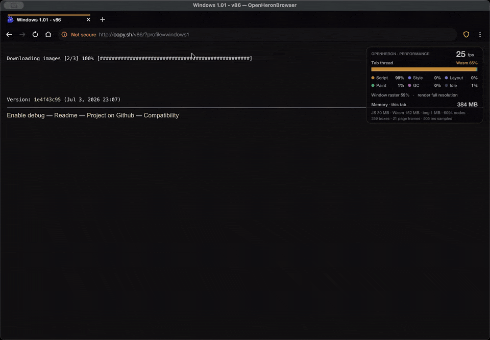<br><sub><b>Windows 1.01 in v86</b>: an x86 emulator in WebAssembly boots it, then Notepad</sub></td>
    <td width="50%" align="center">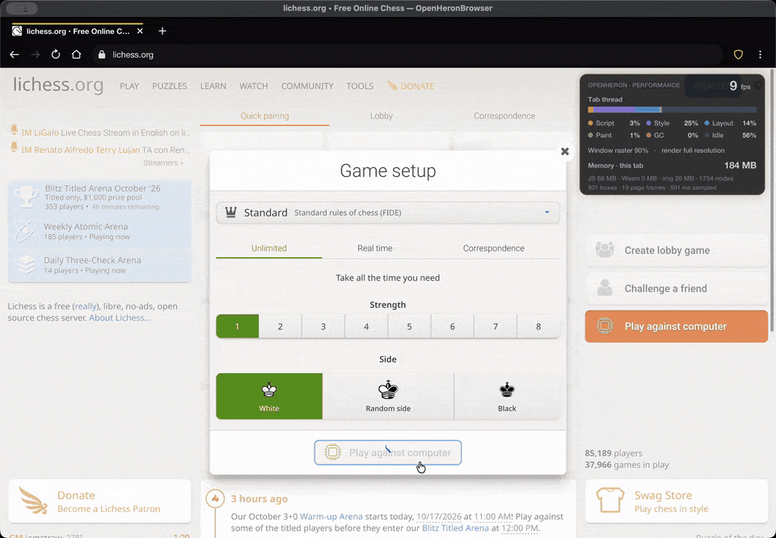<br><sub><b>lichess.org</b>: starting and playing a game against Stockfish</sub></td>
  </tr>
  <tr>
    <td width="50%" align="center">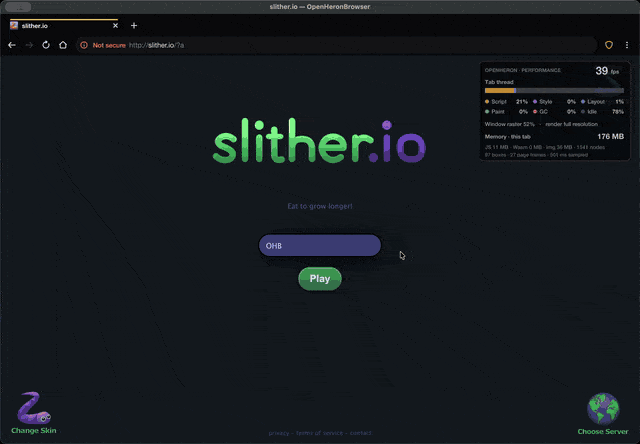<br><sub><b>slither.io</b>, with the performance overlay</sub></td>
    <td width="50%" align="center">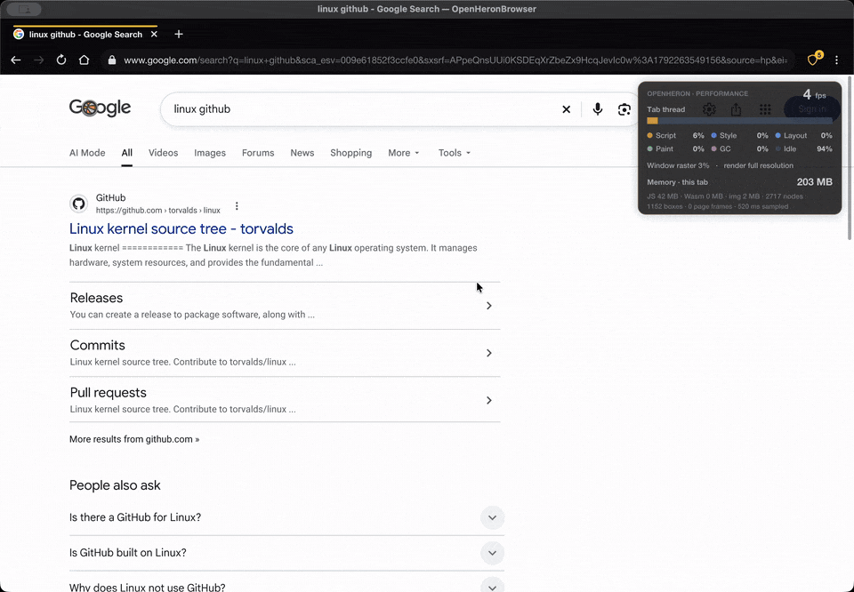<br><sub><b>Google → GitHub</b>: searching and browsing the Linux repository</sub></td>
  </tr>
  <tr>
    <td width="50%" align="center">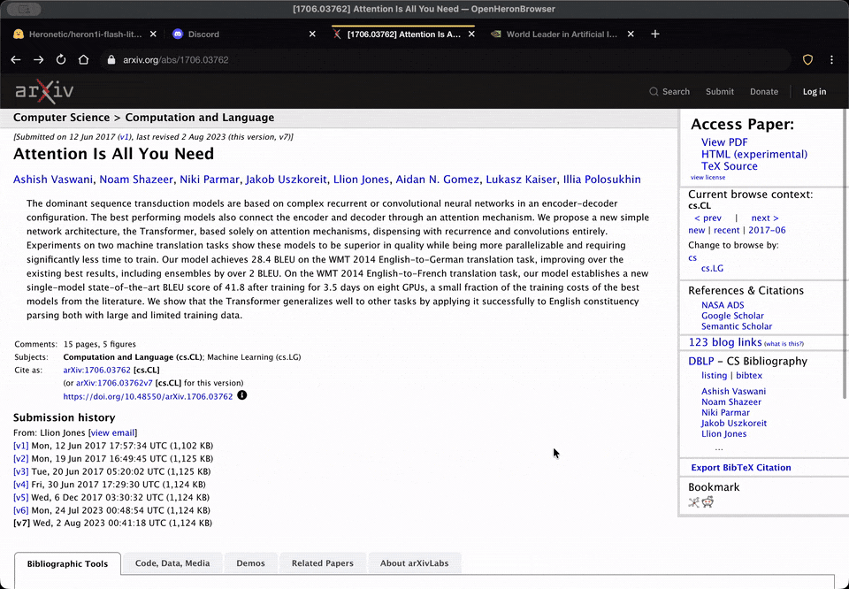<br><sub><b>arXiv</b>: a paper opened in the built-in PDF viewer</sub></td>
    <td width="50%" align="center">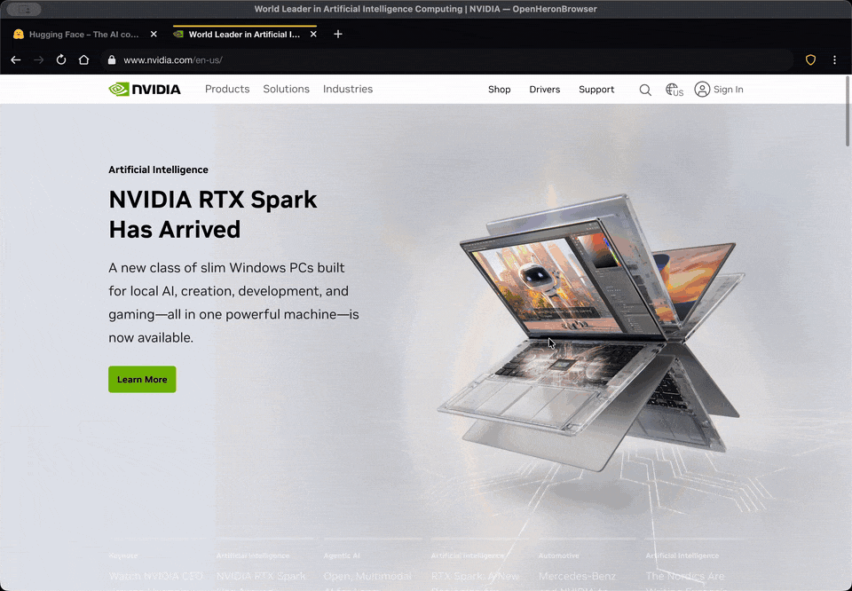<br><sub><b>NVIDIA and Hugging Face</b>: scrolling and model search</sub></td>
  </tr>
  <tr>
    <td width="50%" align="center">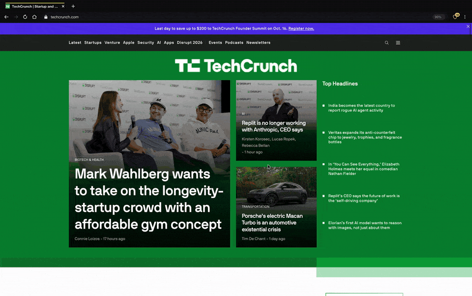<br><sub><b>TechCrunch</b>: the front page and an article, with HeronBlock on</sub></td>
    <td width="50%" align="center">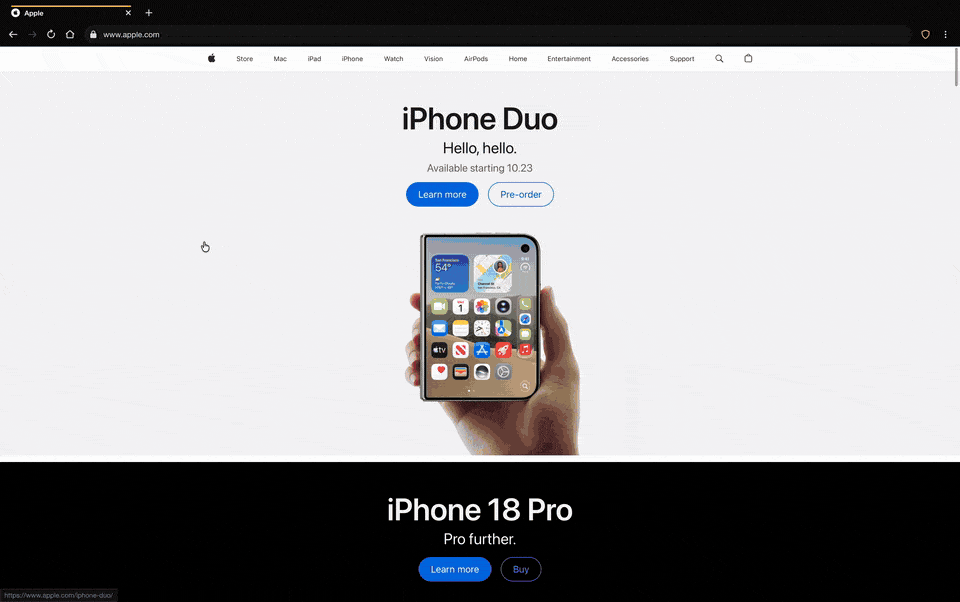<br><sub><b>Apple</b>: scrolling an image-heavy home page</sub></td>
  </tr>
</table>

<p align="center">
  <a href="docs/screenshots/ohb-top12-grid.png">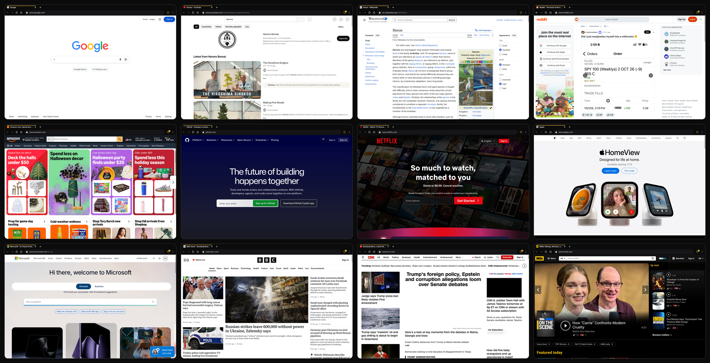</a><br>
  <sub>Twelve popular sites rendered by OpenHeronBrowser: Google, YouTube, Wikipedia, Reddit, Amazon, GitHub, Netflix, Apple, Microsoft, BBC, CNN and IMDb. Click for full size.</sub>
</p>

Almost every browser today is built on one of three engines: Chromium's Blink, Apple's WebKit, or Mozilla's Gecko. OpenHeronBrowser (OHB) is a desktop browser for macOS, Windows and Linux, built on a fourth engine that is small and readable enough for one person to study end to end. Version 1.0.0 is a released demo you can download and use.

The engine and the browser around it are about **85,000 lines of Rust**, plus about **23,000 lines of JavaScript** that implement the DOM and Web APIs on top of the engine. JavaScript itself runs on [Boa](https://github.com/boa-dev/boa), an interpreter written in Rust, with patches for speed and correctness vendored in `vendor/`. WebAssembly runs on [wasmi](https://github.com/wasmi-labs/wasmi).

| Code (version 1.0.0) | Files | Lines | Without blanks and comments |
|---|---:|---:|---:|
| Rust: engine, browser and crypto (`src/`, `crates/`, `build.rs`) | 81 | 85,432 | 76,136 |
| JavaScript: DOM and Web APIs (`src/js/`) | 9 | 22,886 | 21,491 |
| Bundled third-party JavaScript (`src/js/editing.js`, the HTML Editing APIs reference implementation) | 1 | 8,560 | 4,654 |
| Patched copies of Boa, the JavaScript interpreter, and the `url` crate (`vendor/`) | 629 | 227,280 | 157,928 |

```
ohb                                   # open the browser
ohb https://en.wikipedia.org          # open URLs in tabs
ohb --screenshot out.png https://example.com --width 1280 --height 800   # headless render
```

<p align="center">
  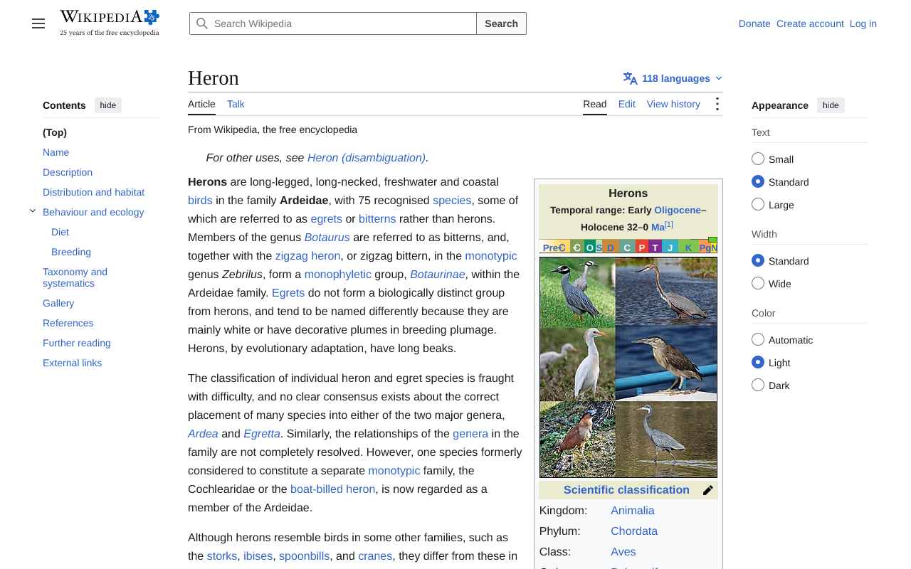
</p>

## Standards and test results

| Test | Result |
|---|---|
| **Acid3** | **97/100**, the same score as current Chromium. The three failing subtests (23, 25, 35) test behavior the DOM spec changed in 2011, and every modern browser fails them too. |
| **Acid2** | Passes: the smiley face matches the reference rendering. |
| **[html5test.com](https://html5test.com)** | **483/555**, with every HTML parsing rule passing. Firefox scores 509/555 and Chrome 523/555. |
| **[web-platform-tests](https://web-platform-tests.org)** | Run against the real WPT server. Recent subsets: DOM nodes, ranges and events, CSSOM View, UI Events, forms and selectors together pass **66,596 of 69,049** subtests (96%). CSS property interpolation passes **40,538 / 42,639**, and WebAssembly's JS API passes **1,906 / 2,215**. |

<p align="center">
  
  &nbsp;
  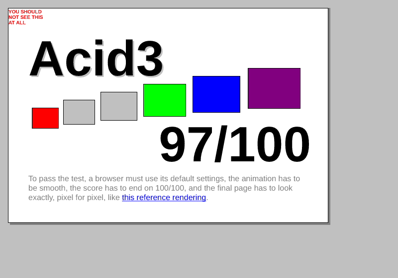
</p>

## What it can run

Most websites render. Script-heavy ones are slower than in Chrome, because JavaScript is interpreted, not compiled (see [Limitations](#limitations)). Sites tested by hand include:

- **Sign-in flows:** logins work on Microsoft / Outlook, GitHub and Hugging Face, and reCAPTCHA challenges pass.
- **Big web apps:** X (Twitter), Reddit, YouTube (browsing works, video playback doesn't yet), claude.ai, ChatGPT, duck.ai and Mastodon. Discord opens and signs in.
- **Editors and tools:** VS Code for the Web (vscode.dev), svgviewer.dev (CodeMirror), Snap! and paint.js.org.
- **Emulators:** JSLinux boots Linux in the browser, and [v86](https://copy.sh/v86/?profile=windows1) boots Windows 1.01 (both in WebAssembly).
- **Games:** lichess.org (including live games), Super Mario Bros. (supermarioplay.com), skribbl.io and Wordle.
- **News and reference:** Wikipedia (including its editor), Reddit, CNN, BBC, PyPI, Hugging Face model cards, and docs sites with Mermaid diagrams.
- **Benchmarks:** MotionMark 1.2 runs.

<p align="center">
  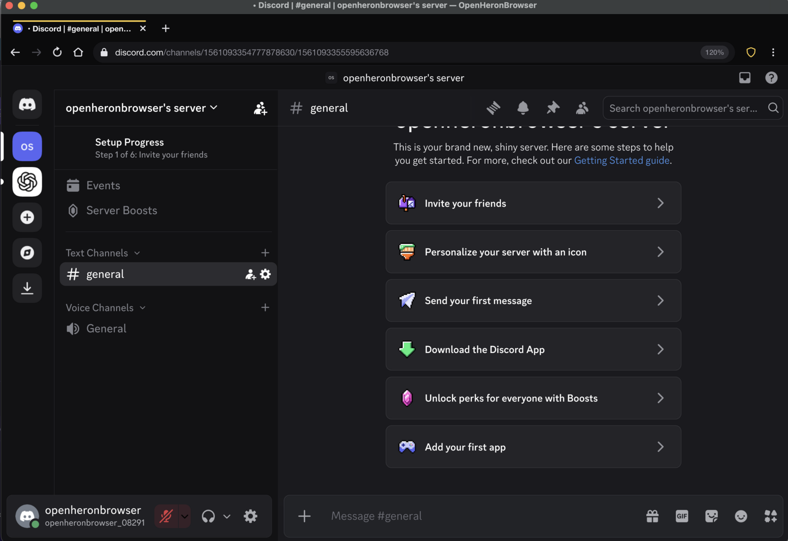
</p>

## What's inside

<p align="center">
  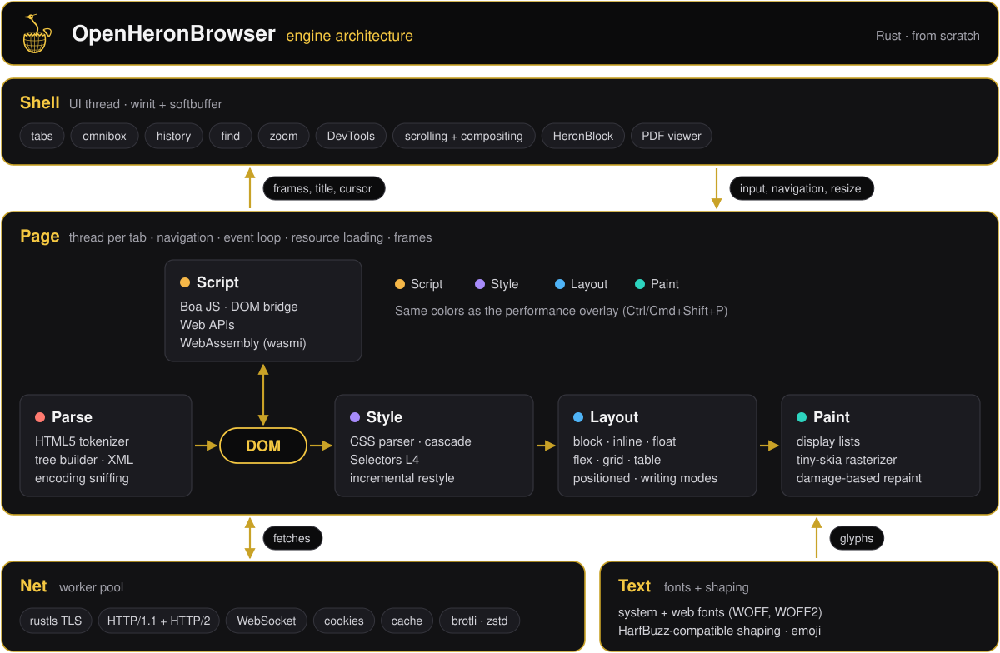
</p>

- **HTML and DOM:** an HTML5 parser, the DOM Standard with Shadow DOM and custom elements, forms and editing.
- **CSS:** Selectors 4 (`:has`, nesting), cascade layers, container queries, modern colors, animations and transitions, incremental restyles.
- **Layout:** block, inline and floats, flexbox, grid (with row subgrid), tables, positioning and vertical writing modes.
- **Painting:** filters, blend modes, masks, 3D transforms, canvas 2D, AVIF/WebP/SVG images and partial repaint.
- **JavaScript:** Boa with speed patches, plus `fetch`, Workers, Streams, IndexedDB, WebCrypto, `Intl` and WebAssembly (with SIMD).
- **Browser:** tabs, omnibox, a built-in PDF viewer, the HeronBlock content blocker, a performance overlay and DevTools.
- **Security:** memory-safe Rust, crashed tabs don't take down the others, certificates are always verified.

<details>
<summary><b>Full feature list</b></summary>

**HTML and DOM**
- An HTML5 tokenizer and tree builder: implied tags, tables, `<template>`, foreign SVG/MathML content and encoding sniffing.
- The DOM Standard: mutation algorithms, `Range`, `TreeWalker`, `MutationObserver`, Shadow DOM (slots, declarative roots, event retargeting) and custom elements with `ElementInternals`.
- Forms with validation, selection, IME input, contenteditable editing commands, and `document.write`.

**CSS**
- Selectors level 4 (`:is`, `:where`, `:not`, `:has`, nesting) and the cascade with `@layer`, `@scope`, `revert` and `revert-layer`.
- `@media`, `@supports`, `@container`, `@font-face` with `unicode-range`, `@property`, and custom properties.
- `calc()` and the math functions, `color-mix()`, `oklch()` and the other modern color spaces.
- CSS animations and transitions plus the Web Animations API, interpolating every animatable property.
- Incremental restyles. Mutations record exactly what changed, and per-selector invalidation sets pick the elements to restyle.

**Layout**
- Block layout with margin collapsing, floats and clearance, and inline layout with line breaking, `white-space` and `text-overflow`.
- Flexbox, CSS Grid (named areas, auto-placement, row subgrid) and tables.
- Absolute, fixed and sticky positioning, vertical writing modes and ruby.
- `shape-outside`, `aspect-ratio`, container queries and MathML Core basics.

**Painting**
- Rounded borders, gradients, box and text shadows, `filter`, `backdrop-filter`, `mix-blend-mode`, masks and `clip-path`.
- 3D transforms with `preserve-3d`, rendered through projective warp layers.
- Images in PNG, JPEG, GIF, WebP, AVIF (through a pure-Rust AV1 decoder) and SVG.
- A full canvas 2D context.
- Partial repaint: only the region that changed between frames is redrawn, and scrolling shifts pixels instead of redrawing.

**JavaScript and Web APIs** (on Boa, modern ECMAScript)
- `fetch`, XHR, WebSocket, Workers, MessageChannel, Streams, Compression Streams, `structuredClone`, and `IndexedDB`, `localStorage` and `cookieStore`.
- WebCrypto (`SubtleCrypto`, in `crates/ohb-crypto`), `Intl`, WebAssembly (with SIMD), Web Audio decoding, Cache Storage and `scheduler`.
- Engine work done for this project:
  - A fast path for variable lookups.
  - Lazily materialized environments.
  - Parse caching across realms.
  - A garbage collector tuned for big apps (depth-first marking, collection during input pauses).

**Browser shell**
- Tabs, an omnibox with history suggestions, back/forward, find in page and zoom.
- A black shell by default (a light theme is in Settings), with a heron-gold accent.
- **Settings** (menu → Settings, `ohb://settings`): search engine (Google, DuckDuckGo or Bing), the address bar's placeholder text (default "Search with OpenHeronBrowser"), theme, and saved site permissions.
- **Permissions:** sites ask before reading the clipboard, and every download asks before anything is saved. Answers are remembered per site and can be reset in Settings.
- **A built-in PDF viewer:** PDFs open in the tab, rendered with [hayro](https://github.com/LaurenzV/hayro). Pages are drawn as they scroll into view and dropped when far away.
- **A performance overlay** (menu → Performance overlay, or Ctrl/⌘+Shift+P) sits in the top-right corner. It is translucent, lets clicks through, and fades further while the pointer is over it. It shows the share of time spent in script (JavaScript and WebAssembly, with the WebAssembly part), style, layout, paint and garbage collection, frames per second, how much of the window is redrawn, and memory use (process, JS heap, WebAssembly memory, images, DOM nodes and layout boxes).
- **Reduced-resolution rendering** (menu → Render resolution, or Ctrl/⌘+Shift+R) draws pages at ½ or ¼ resolution and scales them up with sharp (nearest-neighbor) pixels, trading sharpness for speed on heavy pages.
- **HeronBlock**, the built-in content blocker: ad and tracker requests, common ad placeholders, and new tabs opened to ad hosts.
- Background tabs that haven't been used for a while are put to sleep to save memory, and reload when you return to them.
- **Restart browser** (menu): starts a fresh browser process that reopens the open tabs on the same active tab, giving back all of the old process's memory.
- When started without a terminal, error output is kept in the profile folder (`ohb.log`, and `ohb.prev.log` for the previous run), including where any crash happened.
- Scrolling happens in the window, so it stays smooth while a page's scripts are busy (unless the page asks to handle the wheel itself).
- View-source, a DevTools panel (Elements, Console, Network), and a persistent profile (cookies, storage, history) with a per-site storage manager.

**Security model**
- Written in memory-safe Rust apart from a few FFI points.
- A crashing tab shows an error page, and the other tabs keep running.
- Certificates are always verified (missing intermediate certificates are fetched, as browsers do), and active mixed content is upgraded to HTTPS.
- Third-party cookies follow `SameSite` rules.
- Pages can't read local files, and internal `ohb://` pages are not reachable from the web.

</details>

## Limitations

**A demo, not a daily driver.** Don't use it for banking, work or anything sensitive. It's still improving. The main gaps today:

- **Not sandboxed:** tabs share one process. A crashed tab won't take the browser down, but pages aren't isolated.
- **No GPU acceleration:** drawing is CPU-only, so big windows and heavy effects are slower.
- **No JIT:** JavaScript is interpreted, so large apps like VS Code and Discord feel slower.
- **Media and graphics:** no full audio playback yet, no video playback, no WebGL and no WebAssembly threads.
- **No incremental HTML parsing:** a few pages lay out differently, such as Wordle's board.
- **Sign-ins:** Google blocks Gmail sign-in, and Cloudflare's managed challenge usually fails. reCAPTCHA and other sign-ins work.
- **No sync or password manager.** Extensions are limited to HeronBlock and unpacked extensions.

<table>
  <tr>
    <td width="50%" align="center">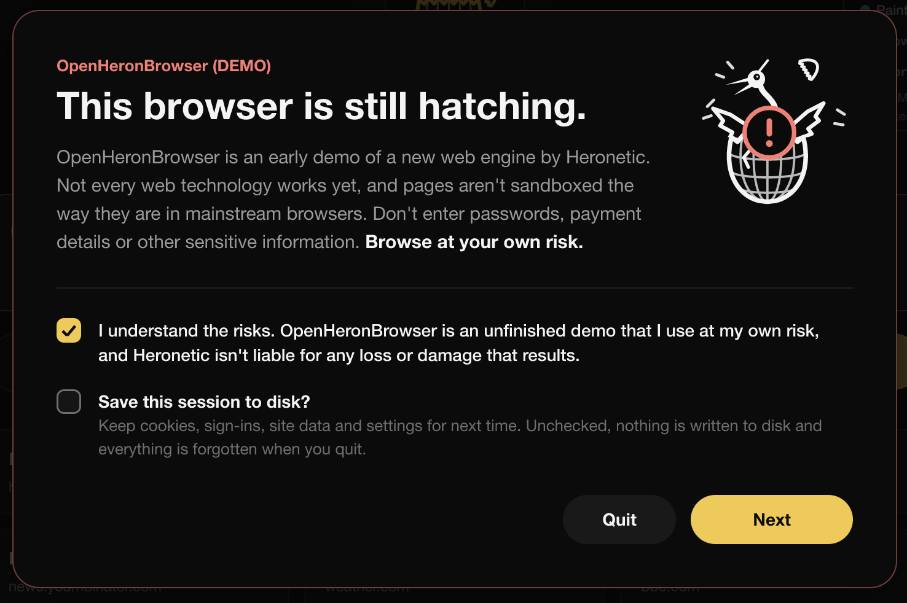<br><sub>The warning shown at startup, with the option to keep nothing on disk</sub></td>
    <td width="50%" align="center">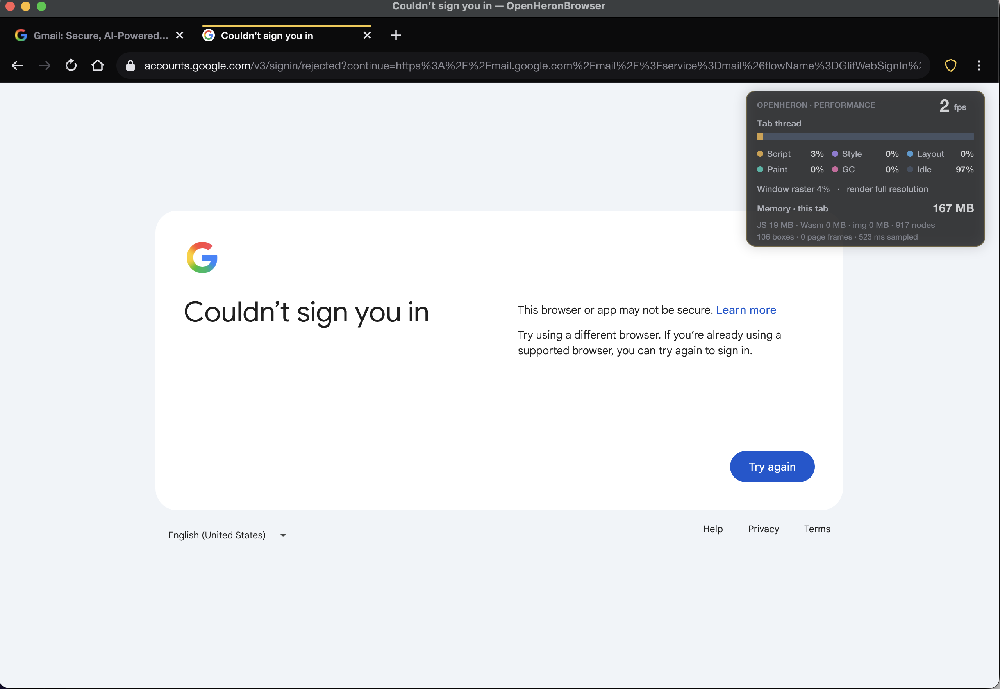<br><sub>Google refusing a Gmail sign-in</sub></td>
  </tr>
</table>

## Downloads

Get the latest version from the [Releases page](../../releases/latest).

| Platform | Package |
|---|---|
| **Windows** 10/11 (x64) | `OpenHeronBrowser-1.0.0-windows-x64.zip` |
| **macOS** 11+, Apple Silicon and Intel (one universal app) | `OpenHeronBrowser-1.0.0-macos-universal.zip` |
| **Linux** x86_64 (glibc 2.17+) | `OpenHeronBrowser-1.0.0-linux-x86_64.tar.gz` |
| **Linux** arm64 (glibc 2.17+) | `OpenHeronBrowser-1.0.0-linux-arm64.tar.gz` |

They are unsigned or ad-hoc signed.
- **macOS:** the first time, right-click the app and choose **Open**. If macOS says it is damaged, run `xattr -dr com.apple.quarantine OpenHeronBrowser.app`.
- **Windows:** SmartScreen asks for **More info → Run anyway**. Run `OpenHeronBrowser.exe`.
- **Linux:** run `./ohb`, or `./install.sh` to add it to your app menu (installs to `~/.local`). It needs an X11 or Wayland desktop.

## Logo

<p>
  
</p>

The logo is the Heronetic heron hatching from a cracked wireframe-globe egg.

## Building from source

You need Rust 1.90 or newer and a C compiler. Then:

```
cargo build --release
./target/release/ohb
```

Full instructions for macOS, Linux and Windows, cross-compiling, packaging, debugging switches and tests are in **[BUILDING.md](BUILDING.md)**.

## Acknowledgements

OpenHeronBrowser stands on excellent open-source Rust crates:
- [Boa](https://github.com/boa-dev/boa) for JavaScript.
- [wasmi](https://github.com/wasmi-labs/wasmi) for WebAssembly.
- [tiny-skia](https://github.com/RazrFalcon/tiny-skia) for rasterization.
- [resvg](https://github.com/linebender/resvg) for SVG.
- [rustybuzz](https://github.com/harfbuzz/rustybuzz) for text shaping.
- [rustls](https://github.com/rustls/rustls) for TLS.
- [rav1d](https://github.com/memorysafety/rav1d) for AV1.
- [Symphonia](https://github.com/pdeljanov/Symphonia) for audio decoding.
- [winit](https://github.com/rust-windowing/winit) for windows and input.

See [THIRD_PARTY_NOTICES.md](THIRD_PARTY_NOTICES.md) for licenses.

## Credits

- Marissa Tanner (Heronetic)
- Claude Opus 5.5 (AI tool)

## License

Copyright 2026 Marissa Tanner, Heronetic. Licensed under the [Apache License, Version 2.0](LICENSE). See [NOTICE](NOTICE). Bundled third-party code keeps its own licenses ([THIRD_PARTY_NOTICES.md](THIRD_PARTY_NOTICES.md)).
